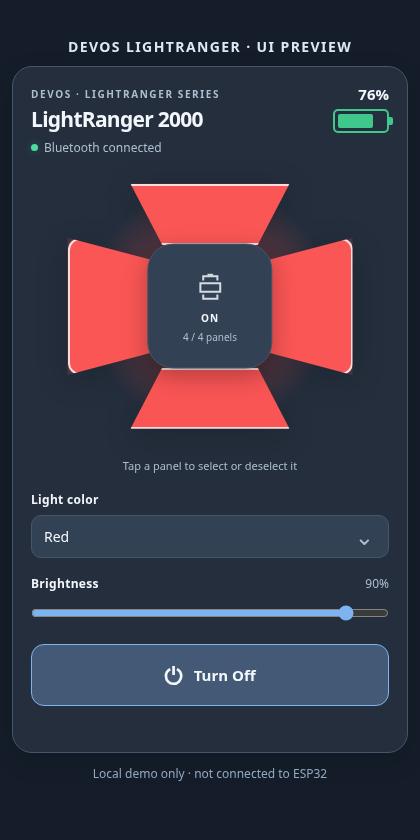

# Devos LightRanger 2000 card



**Portable four-panel controller for Home Assistant and Raspberry Pi dashboards.**

This project ships one framework-independent Web Component (`devos-lightranger-view`) and two small adapters:

- **Home Assistant** — `custom:devos-lightranger-card`, uses existing ESPHome entities and `hass.callService`.
- **Raspberry Pi** — `<devos-lightranger-pi>`, talks over same-origin HTTP and WebSocket to an `aioesphomeapi` Python service that controls the **same ESP32** directly.

No Stack In Card, Button Card, Node/npm dependencies, cloud service, or changes to ESPHome Bluetooth packet construction are needed.

Features: battery percentage with green/amber/red status; ESP32/Bluetooth state; four geometric tap targets; White/Amber/Red selector; brightness slider; separate on/off button. Selected panels are shown muted while powered off; illuminated panels follow selected color while powered on. Responsive layout for phone/tablet/desktop.

> **Status: prototype / hardware validation pending.** This package was syntax- and browser-tested with simulated entity states, but was **not** tested against your live HA instance or your LightRanger. The Pi adapter uses the documented `aioesphomeapi` client, but your exact ESPHome entity names and device key mapping should be checked on first connection. No GitHub repository has been published for you automatically.

## 1. Preview without hardware

From the cloned/unzipped repository root, run:

```shell
python3 -m http.server 8088
```

Visit `http://localhost:8088/demo/offline.html` (or SSH tunnel the port to your computer). It simulates 76% battery and lets you tap panels, choose color, adjust brightness and toggle power; **nothing is sent to a real device**.

## 2. Install in Home Assistant

### Manual install (works before you publish a GitHub repository)

1. Copy `dist/devos-lightranger-card.js` to your HA configuration directory at `config/www/devos-lightranger-card.js` (create `www` if needed).
2. In **Settings → Dashboards → ⋮ → Resources**, add URL `/local/devos-lightranger-card.js` with type **JavaScript module**. In YAML-managed dashboards, add it to `resources` yourself.
3. Refresh the dashboard browser. Add a **Manual** card and paste one of the configurations below.

> Installing the file manually avoids needing a GitHub repository/HACS while the first hardware test is in progress.

### Install through HACS (Dashboard custom repository)

Version **0.1.1**. HACS installs only the Home Assistant browser card. Your
ESPHome device/entities must already exist; the Pi backend is installed separately.

1. Publish the contents of this folder in a **public** GitHub repository named
   `devos-lightranger-card`. The repository root must directly contain
   `hacs.json`, `README.md`, `dist/`, `src/` and `.github/`.
   Do not upload the ZIP as the repository's only file or add an extra nested folder.
   Include hidden files, add a repository description, and topics such as
   `home-assistant`, `hacs`, `lovelace-custom-card`.
2. In HACS, open **⋮ → Custom repositories**, enter your actual GitHub repository
   URL and select **Dashboard** (older HACS versions may call this **Lovelace**).
   Add it, find **Devos LightRanger 2000 Card**, and choose **Download**.
3. Check **Settings → Dashboards → ⋮ → Resources** (enable Advanced Mode in your
   profile if needed). If HACS has not registered it, add
   `/hacsfiles/devos-lightranger-card/devos-lightranger-card.js` as a
   **JavaScript module**. YAML-managed resources: see
   [examples/hacs-resources.yaml](examples/hacs-resources.yaml).
4. Remove any old `/local/devos-lightranger-card.js` resource entry so the browser
   loads one version. Refresh the browser, then add the Manual card YAML below.
5. For updates, download the new version in HACS and reload the dashboard; clear
   browser cache if the old card persists. Check the resource URL if the custom
   element is reported as missing.

### Maintainer build and releases

No npm dependencies or install step are required. Use Python 3.10+ and Node 22+:

```shell
python tools-build.py
npm test
python -m compileall -q backend
```

Commit regenerated `dist/` files with every source change. Checks rebuild and
reject stale bundles. For release, update `package.json` and `CHANGELOG.md`,
commit, then push a matching tag (this package uses `v0.1.1`). The release
workflow validates it and creates a GitHub Release with all three standalone
`.js` assets. Tag pushes require GitHub Actions and repository content-write
permission for the release job. To publish manually, create the matching release
and attach `dist/*.js` directly.

The HACS entry point is `dist/devos-lightranger-card.js`, a complete bundle
with no remote imports. `hacs.json` explicitly selects its filename and uses
`content_in_root: false`. The other bundles remain available for Pi and preview
use. **Do not set `zip_release`**: that option is for integrations, not
Dashboard plugins. The downloadable project ZIP is for preparing your GitHub
repository, not a HACS plugin release asset.

A default-branch install works before the first release because `dist/` is
committed. Releases must include the matching standalone card asset. HACS does
not install the Python service, demos, or source tree as a backend integration.
This project needs no `custom_components/` directory or integration
`manifest.json`.

References: [HACS plugin structure](https://www.hacs.dev/docs/publish/plugin/),
[HACS manifest](https://hacs.dev/docs/publish/start/).

### Recommended YAML (select + number + master light)

This example targets the **monochromatic/light-with-dropdown** arrangement:

```yaml
type: custom:devos-lightranger-card
light: light.devos_lightranger_lightranger
battery: sensor.devos_lightranger_lightranger_battery
connection: binary_sensor.devos_lightranger_bluetooth_connected
synchronized: binary_sensor.devos_lightranger_light_state_synchronized
color: select.devos_lightranger_light_color
brightness: number.devos_lightranger_brightness
panels:
  - switch.devos_lightranger_panel_1_selected   # top
  - switch.devos_lightranger_panel_2_selected   # right
  - switch.devos_lightranger_panel_3_selected   # bottom
  - switch.devos_lightranger_panel_4_selected   # left
```

**Entity names are examples, not verified entity IDs.** Open **Developer Tools → States** in your HA and replace them with the actual IDs. In earlier versions of your ESPHome YAML the panel entities were named `Panel 1`, `Panel 2`, etc. (and likely have IDs ending `_panel_1` rather than `_panel_1_selected`). In one earlier version the master on/off was `switch.*_light_power` rather than `light.*`. If so add:

```yaml
power: switch.devos_lightranger_light_power
```

and set `light:` to your actual light entity if one exists. For configurations using `switch` power and no native `light` entity, see the limitation below.

### RGB-light-only fallback

The saved `devos-lightranger-single-packet.yaml` exposes a single **virtual RGB** `light` but does not expose a `select` or `number` entity. The adapter automatically falls back to `light.turn_on` with preset RGB values and the HA native brightness value. Omit the `color:` and `brightness:` keys or set them to absent IDs:

```yaml
type: custom:devos-lightranger-card
light: light.devos_lightranger_lightranger
battery: sensor.devos_lightranger_lightranger_battery
connection: binary_sensor.devos_lightranger_bluetooth_connected
panels:
  - switch.devos_lightranger_panel_1_selected
  - switch.devos_lightranger_panel_2_selected
  - switch.devos_lightranger_panel_3_selected
  - switch.devos_lightranger_panel_4_selected
```

**Important:** On that older RGB firmware, changing color invokes `light.turn_on` and therefore can turn on an off lantern. If preserving selection while off is required, use the separate `select`/`number` firmware interface or enhance ESPHome before relying on it. Brightness fallback may similarly turn it on. Color is intentionally limited to White, Amber, Red: the physical lantern does not support arbitrary RGB mixing.

### Possible older power-switch-only firmware

Some of your earlier firmware versions have `switch.*_light_power` + `select.*_light_color` + `number.*_brightness` but **no light entity**. The card supports that with `power:` set to the switch **and** `light:` set to that same switch (for connection detection); color and brightness work through their independent entities. Example:

```yaml
type: custom:devos-lightranger-card
light: switch.devos_lightranger_light_power
power: switch.devos_lightranger_light_power
color: select.devos_lightranger_light_color
brightness: number.devos_lightranger_brightness
battery: sensor.devos_lightranger_lightranger_battery
connection: binary_sensor.devos_lightranger_bluetooth_connected
panels:
  - switch.devos_lightranger_panel_1
  - switch.devos_lightranger_panel_2
  - switch.devos_lightranger_panel_3
  - switch.devos_lightranger_panel_4
```

## 3. Run the Pi bridge

The Raspberry Pi talks directly to **the ESP32's ESPHome Native API**, not to HA and not to Bluetooth itself. This requires that the ESP32 and Pi can reach one another on the camping network. On a camping router with no internet, this still works.

```bash
cd devos-lightranger-card
python3 -m venv .venv
source .venv/bin/activate
pip install -r backend/requirements.txt
export LIGHTRANGER_HOST=devos-lightranger.local # or your ESP32 IP
export LIGHTRANGER_PORT=6053
export LIGHTRANGER_ENCRYPTION_KEY='your ESPHome Native API noise PSK'
uvicorn backend.app:app --host 127.0.0.1 --port 8765
```

- Obtain the encryption key from your local ESPHome secrets/configuration; **never commit it to GitHub** or embed it in client-side JS. `LIGHTRANGER_ENCRYPTION_KEY` is not the Wi-Fi password. It is the `api.encryption.key` secret.
- Test on the Pi: `curl http://127.0.0.1:8765/api/lightranger/state`.
- Open the built-in Pi page locally: `http://127.0.0.1:8765/` (or SSH forward port 8765).
- API end points: `GET /api/lightranger/state`, `POST /api/lightranger/command`, `WS /api/lightranger/ws`. The browser uses the WebSocket for live updates. The command endpoint returns **accepted**, not confirmed on the lantern; current state comes via ESPHome notifications.

If your Pi dashboard already has a web server, reverse proxy **both** `/api/lightranger/` and the WebSocket endpoint to the loopback-bound Python server, then host `dist/devos-lightranger-pi.js` as a static JS resource. Embed:

```html
<script type="module" src="/static/devos-lightranger-pi.js"></script>
<devos-lightranger-pi api-path="/api/lightranger"></devos-lightranger-pi>
```

Use a same-origin URL (no browser-to-ESPHome direct calls). This avoids CORS issues and does not expose your native ESPHome encryption key to mobile browsers.

### Optional service at boot

Use `examples/lightranger.service` as a systemd example, adjust the install path and user, save your native API encryption key in a root-owned `0600` environment file at `/etc/lightranger.env`, then run `sudo systemctl daemon-reload && sudo systemctl enable --now lightranger`. The bridge remains bound to the loopback interface.

### Example Nginx reverse proxy path

```nginx
location /api/lightranger/ {
    proxy_pass http://127.0.0.1:8765/api/lightranger/;
    proxy_http_version 1.1;
    proxy_set_header Upgrade $http_upgrade;
    proxy_set_header Connection "upgrade";
    proxy_set_header Host $host;
    proxy_set_header X-Real-IP $remote_addr;
}
```

**Security:** The Python API does **not** implement its own user authentication. Its default `127.0.0.1` bind is intentional. Do not expose port 8765 directly to the internet. Require authentication at the Pi dashboard/reverse proxy or restrict the whole site to your trusted camping LAN/VPN. Requests coming from mobile browsers should be authorized by that outer layer. A public read-only proxy is not enough: `/command` changes physical light state.

### ESPHome entity discovery on Pi

The bridge automatically recognizes the ESPHome Native API entities by name:

| ESPHome name | Role |
|---|---|
| `LightRanger` | Master light |
| `Light Power` (older) | Master power switch |
| `Light Color` | Preset selector |
| `Brightness` | Number entity |
| `LightRanger Battery` | Battery % |
| `Bluetooth Connected` | BLE connection |
| `Light State Synchronized` | State synced |
| `Panel 1 Selected` or `Panel 1`, etc. | Four panel switches |

Each command targets the corresponding entity key as discovered live. No keys or ESP32 MAC address are hard-coded. For older RGB-only firmware without `Light Color`/`Brightness`, the bridge falls back to RGB/brightness light commands.

### Home vs camping network

The ESP32 already prefers camping Wi-Fi, falling back to home Wi-Fi. Both the HA adapter and the Pi adapter can remain installed; each requires network reachability to the ESP32 on the active Wi-Fi network. The adapters do not need a cloud connection. If both sides issue commands concurrently, the last received ESPHome command wins.

## Architecture

```text
src/view.js       ───────────────────────────────┐
                    shared standalone Web Component
                      ├── src/ha-card.js  → Home Assistant entity/service calls
                      └── src/pi-app.js  → same-origin Pi HTTP/WebSocket
backend/app.py    → aioesphomeapi (ESPHome Native API)
ESPHome ESP32     → existing 1-packet BLE implementation → LightRanger
```

### Build artifacts

Run `python3 tools-build.py` to regenerate the three checked-in JS bundles:

- `dist/devos-lightranger-card.js` — HACS/HA (shared view + HA adapter)
- `dist/devos-lightranger-pi.js` — Pi (shared view + Pi adapter)
- `dist/devos-lightranger-view.js` — offline preview core

Single-file bundles ensure HACS can install the HA card without resolving remote JavaScript imports. A simple no-dependency build is deliberate for long-term maintenance.

## Checks and known limitations

- Browser demo simulates state. **No physical integration or BLE behavior is validated** by that demo.
- Panel assignment currently defaults top=1, right=2, bottom=3, left=4. Reorder the HA YAML `panels` list if your real lantern uses a different orientation. The Pi bridge maps panels in numerical order (adjust `infer_role()` or add a mapping later).
- Battery percentage is whatever the ESP32 publishes. Its raw-to-percent formula remains experimental.
- The RGB fallback cannot promise that changing color or brightness while off will leave the light off. Prefer the separate selector/number arrangement for that feature.
- All four panels off will result in no light even if the underlying logical master state remains on, depending on ESPHome firmware; the card does not silently re-enable a panel.
- Current Pi service is designed for a **single** ESPHome LightRanger device. Extend it with per-device namespaces before reusing it for other lights (e.g. ML6).
- UI is responsive and keyboard accessible; browser tests cover simulated controls, but touchscreen usability and VoiceOver/TalkBack still need real-device testing.
